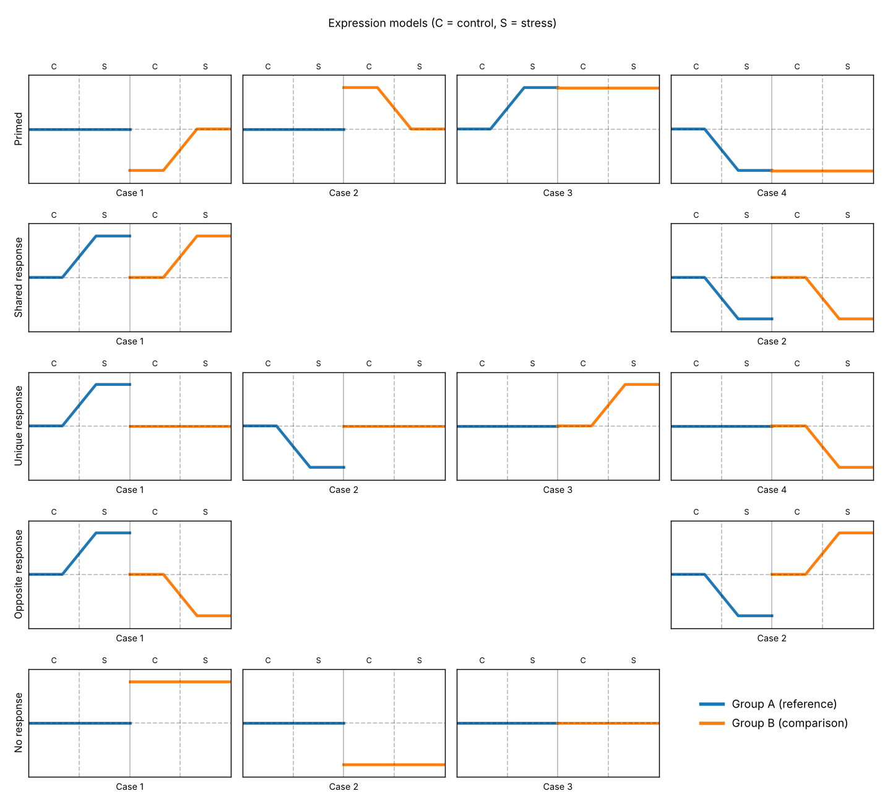

# orthoresponse

Classify genes or ortholog pairs into **expression response models** in a
2 x 2 design: two groups (species, genotypes, cultivars, cell lines) measured
under a control and a stress condition.



| model | meaning |
|---|---|
| **stress-ready** (1-4) | one group responds and reaches the *constitutive* level of the other group, which is therefore primed |
| **shared** (1-2) | both groups respond in the same direction |
| **unique** (1-4) | only one group responds |
| **opposite** (1-2) | both respond, in opposite directions |
| **no response** (1-3) | neither responds (basal level higher, lower or equal) |

The default rules reproduce exactly the decision tree of
Contreras-Riquelme *et al.* (2025) *PLoS One* 20(5): e0324724
([doi:10.1371/journal.pone.0324724](https://doi.org/10.1371/journal.pone.0324724)).
Optional stricter rules handle missing statistics, require a basal difference
for stress-ready calls, and can replace "not significantly different" by a
formal equivalence test.

The same functionality is available in **Python** and **R** with the same
function names; both give identical classifications for identical inputs.

## Installation

**Python** (>= 3.9)

```bash
pip install "orthoresponse[all] @ git+https://github.com/Cold7/orthoresponse.git#subdirectory=python"
```

**R** (>= 4.1)

```r
install.packages(c("BiocManager", "remotes"))
BiocManager::install("DESeq2")
remotes::install_github("Cold7/orthoresponse", subdir = "r-package", build_vignettes = TRUE)
```

## Quick start

```python
import pandas as pd, orthoresponse as orr

counts  = pd.read_csv("counts.tsv",  sep="\t", index_col=0)   # raw counts, genes x samples
samples = pd.read_csv("samples.tsv", sep="\t", index_col=0)   # columns: line, treatment

res = orr.run_orthoresponse(counts, samples, group_col="line", condition_col="treatment",
                            group_a="sensitive", group_b="tolerant",
                            control="control", stress="drought")
res.summary          # number of genes per model and case
res.save("results")
```

```r
library(orthoresponse)
res <- orthoresponse(counts, samples, group_col = "line", condition_col = "treatment",
                     group_a = "sensitive", group_b = "tolerant",
                     control = "control", stress = "drought")
res
save_orthoresponse(res, "results")
```

```bash
orthoresponse run --counts counts.tsv --samples samples.tsv --group-col line \
  --condition-col treatment --group-a sensitive --group-b tolerant \
  --control control --stress drought --out results
```

Already have differential-expression results? Pass the five contrasts to
`classify_responses()`. Working with two species? Use
`reciprocal_best_hits()` and `merge_ortholog_counts()` first.

## Documentation

* **[User manual](docs/manual.md)**: concepts, input formats, decision tree,
  options, outputs, cross-species workflow, worked examples, caveats.
* R vignette: `vignette("orthoresponse")`.
* Worked examples with public, already-counted data (no alignment needed):
  * [`examples/rice_salt_GSE167342`](examples/rice_salt_GSE167342): rice,
    salt-sensitive PL12 vs salt-tolerant *Saltol* introgression line IL22.
  * [`examples/human_osimertinib_GSE232890`](examples/human_osimertinib_GSE232890):
    human lung cancer cells, TP53 R248Q vs empty vector, DMSO vs osimertinib.

## Repository layout

```text
python/        Python package (pip-installable, src layout, pytest suite)
r-package/     R package (roxygen2 docs, testthat suite, vignette)
docs/          user manual and figures
examples/      runnable examples in both languages
tools/         maintenance scripts (shared test fixture)
```

## Citation

If you use orthoresponse, please cite it using the metadata in
[`CITATION.cff`](CITATION.cff) (GitHub's *Cite this repository* button).

## License

MIT, see [LICENSE](LICENSE).
