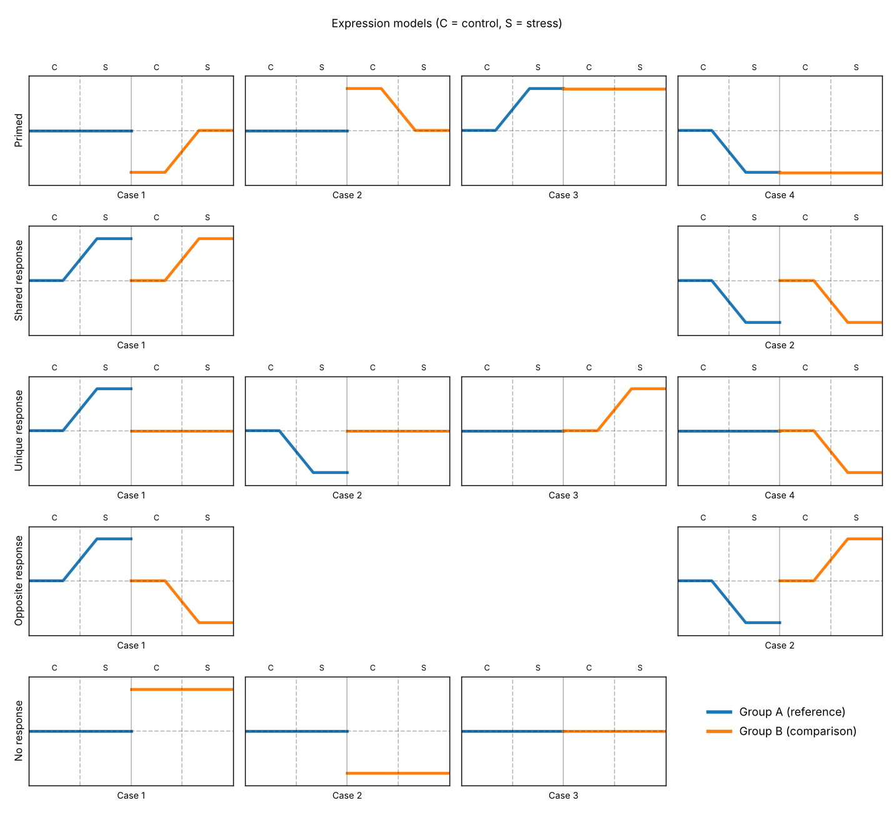
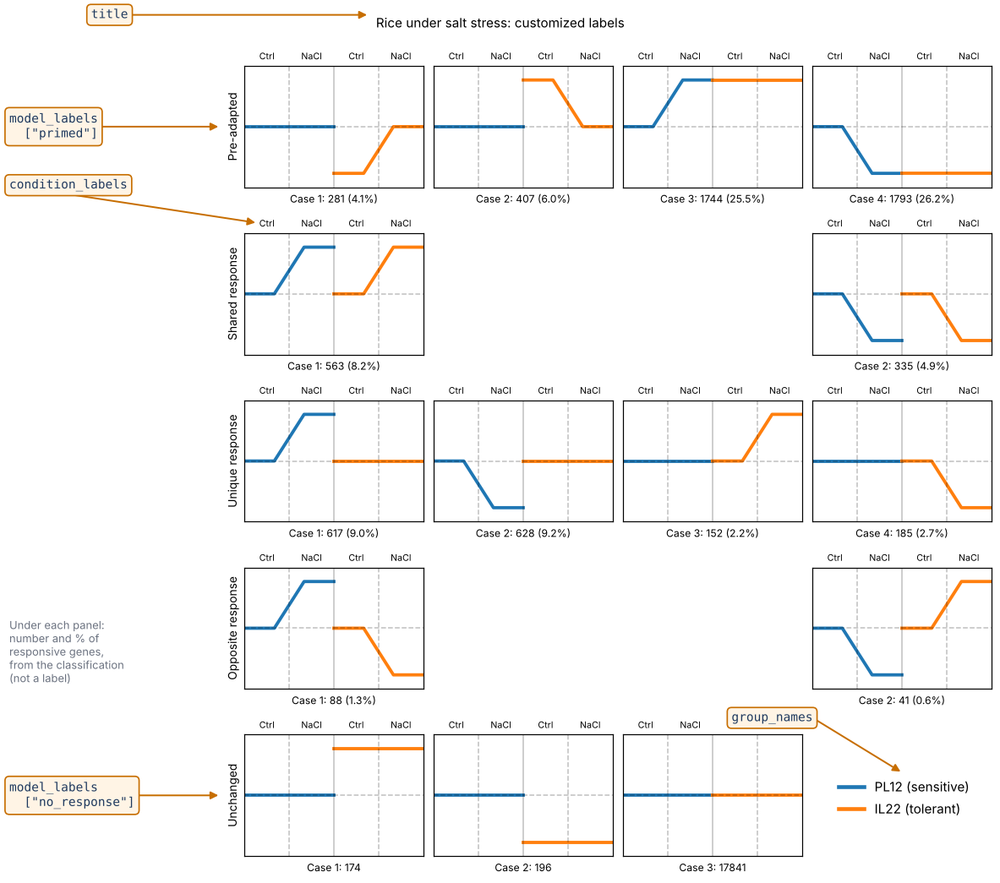

# ALTIRO user manual

*Analysis of Latent Transcriptional Induction and Response Outcomes* (package `altiro`, formerly `orthoresponse`)

Version 0.6.2 · Python and R

`altiro` classifies genes (within one species) or ortholog pairs (between
two species) into **expression response models** in a 2 x 2 design: two
**groups** (species, genotypes, cultivars, cell lines...) measured under a
**control** and a **stress** condition. The default rules reproduce exactly the
decision tree of

> Contreras-Riquelme JS, Contreras M, Moyano TC, Sjoberg R, Jimenez-Gomez J,
> Alvarez JM (2025). Desert-adapted tomato *Solanum pennellii* exhibit unique
> regulatory elements and stress-ready transcriptome patterns to drought.
> *PLoS One* 20(5): e0324724. https://doi.org/10.1371/journal.pone.0324724

The Python and R implementations share the same function names, options and
outputs, and give identical classifications for identical inputs.

---

## Contents

1. [Concepts](#1-concepts)
2. [Installation](#2-installation)
3. [Quick start](#3-quick-start)
4. [Input data](#4-input-data)
5. [What the workflow does](#5-what-the-workflow-does)
6. [The decision tree](#6-the-decision-tree)
7. [Presets and options](#7-presets-and-options)
8. [Outputs](#8-outputs)
9. [Customizing names and labels](#9-customizing-names-and-labels)
10. [Cross-species analyses (orthologs)](#10-cross-species-analyses-orthologs)
11. [Worked examples](#11-worked-examples)
12. [Reproducing the original publication](#12-reproducing-the-original-publication)
13. [Python and R: what is identical and what is not](#13-python-and-r-what-is-identical-and-what-is-not)
14. [Interpretation and statistical caveats](#14-interpretation-and-statistical-caveats)
15. [Function reference](#15-function-reference)
16. [Troubleshooting](#16-troubleshooting)
17. [Citation and license](#17-citation-and-license)

---

## 1. Concepts

### Groups and conditions

| Symbol | Meaning | Example (original publication) |
|---|---|---|
| **A** | reference group, usually the sensitive one | *Solanum lycopersicum* |
| **B** | comparison group, usually the tolerant / adapted one | *Solanum pennellii* |
| control | baseline condition | well watered |
| stress | treatment | 11 days of drought |

Which group you call A and which B only changes the case numbers, not the
biology: primed cases 1-2 always describe **A primed**, cases 3-4
**B primed**.

### The five models



| label | description | primed group |
|---|---|---|
| `primed_1` | B is induced under stress up to the control level of A | A |
| `primed_2` | B is repressed under stress down to the control level of A | A |
| `primed_3` | A is induced under stress up to the control level of B | B |
| `primed_4` | A is repressed under stress down to the control level of B | B |
| `shared_1` / `shared_2` | induced / repressed in both groups | - |
| `unique_1` / `unique_2` | induced / repressed only in A | - |
| `unique_3` / `unique_4` | induced / repressed only in B | - |
| `opposite_1` | induced in A, repressed in B | - |
| `opposite_2` | repressed in A, induced in B | - |
| `no_response_1` / `_2` | no response; B basal level higher / lower than A | - |
| `no_response_3` | no response; no basal difference detected | - |

**Terminology.** Primed features are called *stress-ready* in the original
publication. *Primed* is used here because the method applies to any treatment
(a drug, an infection, a nutrient, a temperature...) and any kind of group, not
only to stress in plants. `classify_responses(..., label_style="stress_ready")`
returns the old names (`stress_ready_1` ... `stress_ready_4`).

Two extra labels exist only with non-default options:
`unresolved_<case>` (equivalence test inconclusive, see 7.3) and
`unclassified` (missing statistics, see 7.1).

A **primed** (or *primed*, *pre-adapted*) gene is one whose constitutive
expression in one group already matches the stress-induced (or stress-repressed)
expression of the other group.

---

## 2. Installation

Replace `Cold7` with the GitHub account that hosts the repository.

### Python (>= 3.9)

```bash
# everything: PyDESeq2, plotting and Excel support
pip install "altiro[all] @ git+https://github.com/Cold7/altiro.git#subdirectory=python"

# classifier only (numpy, pandas, scipy) - enough if you already have contrast tables
pip install "git+https://github.com/Cold7/altiro.git#subdirectory=python"
```

Optional extras: `deseq` (PyDESeq2), `plot` (matplotlib), `excel` (openpyxl),
`all`, `test` (pytest). Check the installation with `altiro --version`.

From a local clone (development mode):

```bash
git clone https://github.com/Cold7/altiro.git
pip install -e "altiro/python[all,test]"
pytest altiro/python/tests
```

### R (>= 4.1)

```r
install.packages(c("BiocManager", "remotes"))
BiocManager::install("DESeq2")
remotes::install_github("Cold7/altiro", subdir = "r-package",
                        build_vignettes = TRUE)
library(altiro)
vignette("altiro")
```

From a local clone: `R CMD INSTALL altiro/r-package`.

---

## 3. Quick start

### Bundled example data

Two real data sets are included: `rice_salt` (GEO GSE167342, see 10.1) and
`ovarian_brequinar` (GEO GSE283381, see 10.2):

```python
ex = alt.load_example("rice_salt")      # ExampleData: .counts, .samples, .params
res = alt.run_altiro(ex.counts, ex.samples, **ex.params)
alt.export_example("my_folder")         # counts.tsv.gz + samples.tsv, as templates
```
```r
ex <- load_example("rice_salt")         # list: counts, samples, params
res <- do.call(altiro, c(list(ex$counts, ex$samples), ex$params))
export_example("my_folder")
```

Command line: `altiro example --out my_folder` writes the two files and
prints the matching `altiro run` command.

### Python

```python
import pandas as pd
import altiro as alt

counts = pd.read_csv("counts.tsv", sep="\t", index_col=0)    # raw counts, genes x samples
samples = pd.read_csv("samples.tsv", sep="\t", index_col=0)  # one row per sample

res = alt.run_altiro(
    counts, samples,
    group_col="line", condition_col="treatment",
    group_a="PL12", group_b="IL22",          # A = sensitive, B = tolerant
    control="Control", stress="Salt",
)
print(res)                  # summary table + asymmetry test (same output as R)
res.summary                 # the table as a DataFrame
res.asymmetry               # the asymmetry test as a DataFrame
res.save("results")         # TSV files + contrast tables + normalized counts
```

### Command line (installed with the Python package)

```bash
altiro run --counts counts.tsv --samples samples.tsv \
  --group-col line --condition-col treatment \
  --group-a PL12 --group-b IL22 --control Control --stress Salt \
  --out results

altiro models --group-names PL12 IL22     # print the model definitions
altiro classify --help                     # classify precomputed contrasts
altiro rbh --help                          # reciprocal best BLAST hits
altiro merge --help                        # merge two species' counts
```

### R

```r
library(altiro)
counts  <- read.delim("counts.tsv", row.names = 1, check.names = FALSE)
samples <- read.delim("samples.tsv", row.names = 1)

res <- altiro(counts, samples,
              group_col = "line", condition_col = "treatment",
              group_a = "PL12", group_b = "IL22",
              control = "Control", stress = "Salt")
res                               # printed summary
save_altiro(res, "results")
plot_model_patterns(res$classification)
```

### Figure labels

`plot_model_patterns()` labels the two conditions "C" and "S" by default.
Choose your own with `condition_labels` (control first, stress second), rename
any of the row labels with `model_labels` (keys `primed`, `shared`,
`unique`, `opposite`, `no_response`; the others keep their defaults), and
optionally replace the title. Shared and opposite responses are drawn in the
first and fourth columns. All naming options (groups, conditions, models,
tables) are described in [section 9](#9-customizing-names-and-labels).

```python
from altiro.plotting import plot_model_patterns
fig = plot_model_patterns(res.classification, condition_labels=("Ctrl", "NaCl"))
fig = plot_model_patterns(res.classification, condition_labels=("C", "D"),   # D = drought
                          group_names=("S. lycopersicum", "S. pennellii"), title="Tomato drought",
                          model_labels={"primed": "Pre-adapted", "no_response": "Unchanged"})
fig.savefig("model_patterns.png", dpi=150)
```
```r
plot_model_patterns(res$classification, condition_labels = c("Ctrl", "NaCl"))
plot_model_patterns(res$classification, condition_labels = c("C", "D"),
                    group_names = c("S. lycopersicum", "S. pennellii"), title = "Tomato drought",
                    model_labels = c(primed = "Pre-adapted", no_response = "Unchanged"))
```

---

## 4. Input data

### 4.1 Count matrix

* **Raw integer counts** (not TPM, FPKM or normalized values), features in rows,
  samples in columns, feature ids in the first column / row names.
* Estimated counts (e.g. Salmon/Kallisto `est_counts`) are accepted with
  `round_counts=True` / `round_counts = TRUE`.
* For two species, first build an ortholog-level matrix (section 10).

### 4.2 Sample table

One row per sample (row names = count-matrix column names) and at least two
columns: the group and the condition. Samples with other levels are dropped
with a warning, so one table can describe a larger experiment.

```text
sample  line  treatment
S40     PL12  Control
S52     IL22  Control
S58     PL12  Salt
S70     IL22  Salt
...
```

Every one of the four cells needs at least one sample; at least 3 replicates
per cell are strongly recommended (section 14).

### 4.3 Precomputed contrast tables (alternative entry point)

If you already ran a differential-expression analysis, call
`classify_responses()` directly with the five contrasts:

| key | numerator vs denominator |
|---|---|
| `a_response` | A stress vs A control |
| `b_response` | B stress vs B control |
| `basal` | B control vs A control |
| `b_stress_vs_a_control` | B stress vs A control |
| `a_stress_vs_b_control` | A stress vs B control |

Each table needs `log2FoldChange` and `padj` (adjusted p-value), plus `lfcSE`
if you use the equivalence test. A positive log2 fold change must mean
*higher in the numerator*, p-values must be adjusted (FDR), and every table
must keep all tested genes (no top lists).

| tool | log2 fold change | adjusted p | standard error |
|---|---|---|---|
| DESeq2 / PyDESeq2 | `log2FoldChange` | `padj` | `lfcSE` |
| edgeR (`topTags`) | `logFC` | `FDR` | not reported |
| limma (`topTable`) | `logFC` | `adj.P.Val` | `stdev.unscaled * sqrt(s2.post)` |

**R, edgeR** (one quasi-likelihood fit, five contrasts):

```r
library(edgeR); library(altiro)
samples$cell <- factor(paste(samples$line, samples$treatment, sep = "_"))
design <- model.matrix(~ 0 + cell, data = samples)
colnames(design) <- levels(samples$cell)
y <- DGEList(counts)
y <- y[filterByExpr(y, design), , keep.lib.sizes = FALSE]
y <- normLibSizes(y)
y <- estimateDisp(y, design)
fit <- glmQLFit(y, design)
con <- makeContrasts(
  a_response            = PL12_Salt    - PL12_Control,
  b_response            = IL22_Salt    - IL22_Control,
  basal                 = IL22_Control - PL12_Control,
  b_stress_vs_a_control = IL22_Salt    - PL12_Control,
  a_stress_vs_b_control = PL12_Salt    - IL22_Control,
  levels = design)
tabs <- lapply(colnames(con), function(k) {
  tt <- topTags(glmQLFTest(fit, contrast = con[, k]), n = Inf, sort.by = "none")$table
  data.frame(log2FoldChange = tt$logFC, padj = tt$FDR, row.names = rownames(tt))
})
names(tabs) <- colnames(con)
cls <- classify_responses(tabs, group_names = c("PL12", "IL22"))
```

**R, limma-voom** (same design and contrasts, with standard errors):

```r
v <- voom(y, design)
lfit <- eBayes(contrasts.fit(lmFit(v, design), con))
tabs <- lapply(colnames(con), function(k) {
  tt <- topTable(lfit, coef = k, number = Inf, sort.by = "none")
  se <- (lfit$stdev.unscaled[, k] * sqrt(lfit$s2.post))[rownames(tt)]
  data.frame(log2FoldChange = tt$logFC, padj = tt$adj.P.Val, lfcSE = se, row.names = rownames(tt))
})
names(tabs) <- colnames(con)
cls <- classify_responses(tabs, group_names = c("PL12", "IL22"))
```

**Python or R, from files** (one file per contrast, gene ids in the first column):

```python
tabs = alt.read_contrasts(paths, lfc_col="logFC", padj_col="FDR")   # limma: padj_col="adj.P.Val"
cls = alt.classify_responses(tabs, group_names=("PL12", "IL22"))
```

**Command line:**

```bash
altiro classify --a-response a.csv --b-response b.csv --basal basal.csv \
  --b-stress-vs-a-control bsac.csv --a-stress-vs-b-control asbc.csv \
  --lfc-col logFC --padj-col FDR --group-names PL12 IL22 --out results_edger
```

On the rice example, edgeR and DESeq2 give the same model for 90% of the genes
tested by both (70% among genes that respond according to DESeq2); the
differences come from the filtering and statistics of each tool.

You can also pass a single wide table whose columns are
`<key>_log2FoldChange`, `<key>_padj` (and `<key>_lfcSE`).

---

## 5. What the workflow does

`run_altiro()` (Python) / `altiro()` (R):

1. **Design.** Samples are mapped to four cells, `A_control`, `A_stress`,
   `B_control`, `B_stress`.
2. **Filtering.** Features with a total count `<= min_total_count` (default
   10, as in the published script) are removed.
3. **Model.** One negative-binomial GLM is fitted to *all* samples with the
   design `~ cell` (DESeq2 in R, PyDESeq2 in Python). Size factors and
   dispersions are therefore estimated across both groups, as in the
   publication.
4. **Contrasts.** The five contrasts of section 4.3 are extracted with
   Benjamini-Hochberg adjustment, Cook's outlier filtering and independent
   filtering (both can be switched off). `filter_alpha` sets the level used by
   the independent filtering; by default it equals `alpha`. The published
   script used 0.01 for filtering and 0.05 for classification
   (`alpha=0.05, filter_alpha=0.01`).
5. **Classification** with the decision tree (section 6).
6. **Summaries**: counts per model with explicit denominators, and the
   primed-asymmetry test.

---

## 6. The decision tree

A contrast is **significant** when `padj < alpha` (and
`|log2FC| >= min_abs_lfc`, default 0). Its **direction** is the sign of the
log2 fold change rounded to `sign_digits` (default 2) decimals.

```text
                    A responds? (a_response significant)
               no  /                                 \ yes
   B responds? (b_response)                    B responds? (b_response)
      no /          \ yes                        no /            \ yes
 NO RESPONSE      B up or down?             A up or down?     SHARED / OPPOSITE
 basal signif.?   B stress vs A control     A stress vs B control   by the two signs:
 +  -> NR 1       not signif.  -> PR 1 (up) not signif. -> PR 3 (up)   + +  -> shared 1
 -  -> NR 2                       PR 2 (down)              PR 4 (down) - -  -> shared 2
 ns -> NR 3       significant  -> UR 3 (up) significant -> UR 1 (up)   + -  -> opposite 1
                                  UR 4 (down)              UR 2 (down) other -> opposite 2
```

(PR = primed, UR = unique response, NR = no response.)

### Flags

The `flags` column records why a call may deserve attention:

* `na_treated_as_not_de`: at least one contrast consulted for this feature had
  a missing adjusted p-value and, under `na_action="not_de"`, it was read as
  "not significant". Missing values come from DESeq2's independent filtering
  (low counts) and Cook's outlier detection.
* `basal_difference_not_significant`: the feature would be primed under
  the paper rules but was demoted to unique because no significant basal
  difference supports it (only with `require_basal_difference`).

---

## 7. Presets and options

| option | `paper` (default) | `strict` | meaning |
|---|---|---|---|
| `alpha` | 0.05 | 0.05 | adjusted p-value threshold |
| `min_abs_lfc` | 0 | 0 | minimum absolute log2FC for "significant" |
| `na_action` | `not_de` | `unclassified` | how missing `padj` is handled |
| `require_basal_difference` | False | True | primed calls need a basal difference |
| `equivalence_margin` | none | none | TOST equivalence for "same level" |
| `sign_digits` | 2 | 2 | rounding before taking the sign |

Any option can be combined with any preset:

```python
alt.classify_responses(tables, preset="strict", equivalence_margin=0.5)
```
```r
classify_responses(tables, preset = "strict", equivalence_margin = 0.5)
```

### 7.1 Missing adjusted p-values (`na_action`)

Under the paper rules a missing value counts as "not different". In the
contrasts that test whether two levels are *equal*, this pushes features
towards the primed class. With `na_action="unclassified"` such features get the
label `unclassified` instead. Most of them are low-count genes removed by the
independent filtering of one contrast.

### 7.2 Basal difference (`require_basal_difference`)

If A is induced up to B's control level (primed 3), B's control level must
be higher than A's control level. The paper rules never check this: they only
check that A-stress is *not significantly different* from B-control. When the
two groups have the same basal level, a gene that responds in A alone (a unique
response) can pass that check simply because the induction is modest. With
this option, a primed call also requires a significant `basal` contrast in
the expected direction (negative for cases 1 and 4, positive for cases 2 and 3);
otherwise the feature becomes the corresponding unique response.

### 7.3 Equivalence (`equivalence_margin`)

"Not significantly different" is not evidence of equality. With
`equivalence_margin = m` (log2 units), the matching contrast must pass a two
one-sided test (TOST) for `|log2FC| < m`:

`p = max( P(Z > (lfc + m)/se), P(Z < (lfc - m)/se) )`, BH-adjusted across
features, which is the construction DESeq2 uses with
`altHypothesis = "lessAbs"`. Features that are neither different nor
equivalent are labelled `unresolved_<case>`. Choose `m` before looking at the
results (0.5 to 1 is common); with 2-3 replicates few genes can be shown to be
equivalent within 0.5 log2 units, which is itself informative.

### 7.4 Which preset should I use?

* To reproduce or compare with the original publication: `paper`.
* To claim that a group is pre-adapted, or when the two groups are
  near-isogenic (e.g. an introgression line and its recurrent parent): `strict`,
  ideally with an equivalence margin, and report both.

---

## 8. Outputs

### 8.1 `classification`

One row per feature (index / row names = feature id):

| column | content |
|---|---|
| `label` | e.g. `primed_3` |
| `model`, `case` | the two parts of the label |
| `primed_group` | group whose control level equals the other's stressed level (primed only) |
| `responding_group` | A, B, `both` or `none` |
| `description` | human-readable sentence with your group names |
| `flags` | see section 6 |
| `<key>_log2FoldChange`, `<key>_padj` | statistics of the five contrasts |

### 8.2 `summary`

`label, model, case, n, pct_of_responsive, pct_of_all`. Two denominators are
reported on purpose:

* `pct_of_responsive`: features that respond in at least one group
  (primed, shared, unique, opposite, unresolved). The percentages in
  Fig. 3 of the original publication use this denominator.
* `pct_of_all`: every classified feature.

### 8.3 `asymmetry` (`primed_asymmetry()`)

Among features that respond in only one group, the fraction that ends in a
primed state, for A-only and B-only responders, compared with Fisher's
exact test. A larger raw number of primed genes in one direction can
simply reflect that one group has more responsive genes; this test removes that
effect. The odds ratio reported is the sample odds ratio
`(SR_A * U_B) / (U_A * SR_B)`.

### 8.4 Files written by `save()` / `save_altiro()`

```text
results/
  classification.tsv
  summary.tsv
  primed_asymmetry.tsv
  normalized_counts.tsv
  contrasts/contrast_<key>.tsv     (full DESeq2 / PyDESeq2 tables)
  model_patterns.png / .pdf        (the 15 patterns with counts and percentages)
  model_summary.png / .pdf         (bar chart: features per model and case)
```

Figures are saved by default. Pass the figure options to the save call, or turn
them off:

```python
res.save("results", condition_labels=("Ctrl", "NaCl"),
         model_labels={"primed": "Pre-adapted"}, formats=("png",))
res.save("results", plots=False)                     # tables only
alt.save_plots(classification, "figures")            # figures for any classification
```
```r
save_altiro(res, "results", condition_labels = c("Ctrl", "NaCl"),
            model_labels = c(primed = "Pre-adapted"), formats = "png")
save_altiro(res, "results", plots = FALSE)
save_plots(classification, "figures")
```

Command line: figures are written by `altiro run` and
`altiro classify`; use `--condition-labels Ctrl NaCl`,
`--plot-formats png` or `--no-plots`.

---

## 9. Customizing names and labels

Every name in the tables and figures can be changed. Some names are **data**
(values of your sample table that tell the package which samples are A, B,
control and stress); the rest are **display labels** that only change what you
read.



### 9.1 Which group is A and which is B

`group_a` and `group_b` choose the roles: A is the reference, B the comparison.
They must be values of `group_col`. Case numbers are defined relative to A and
B, so swapping the groups swaps the cases:

| model | case meaning | after swapping A and B |
|---|---|---|
| primed | 1-2: A is primed; 3-4: B is primed | 1 <-> 3, 2 <-> 4 |
| unique | 1-2: only A responds; 3-4: only B responds | 1 <-> 3, 2 <-> 4 |
| opposite | 1: A up, B down; 2: A down, B up | 1 <-> 2 |
| no_response | 1: B higher; 2: B lower; 3: same level | 1 <-> 2 |
| shared | 1: both up; 2: both down | unchanged |

A common convention is A = sensitive (wild type, untreated line) and B =
tolerant (mutant, resistant line), so that "B is primed" reads as "the
tolerant line is already at the induced level".

### 9.2 Display names of the groups

By default the groups are called by their sample-table values. `group_names`
(A first, B second) renames them without touching the data. Given to the
pipeline, the names are used in the `description`, `primed_group` and
`responding_group` columns, the asymmetry table, the printed result and the
figures.

```python
res = alt.run_altiro(ex.counts, ex.samples, **ex.params,
                     group_names=("Sensitive", "Tolerant"))
print(res)   # altiro result: A = Sensitive | B = Tolerant
```
```r
res <- altiro(ex$counts, ex$samples, group_col = "line", condition_col = "treatment",
              group_a = "PL12", group_b = "IL22", control = "Control", stress = "Salt",
              group_names = c("Sensitive", "Tolerant"))
```
```bash
altiro run ... --group-a PL12 --group-b IL22 --group-names Sensitive Tolerant
```

`classify_responses(..., group_names=)` does the same for precomputed
contrasts. In `save()` / `save_altiro()`, `save_plots()` and
`plot_model_patterns()`, `group_names` changes **only the figure legend**.

### 9.3 Renaming values in the sample table

To make the new names part of the data, rename the values first and use the
new values in `group_a`, `group_b`, `control` and `stress`:

```python
samples["line"] = samples["line"].replace({"PL12": "Sensitive", "IL22": "Tolerant"})
samples["treatment"] = samples["treatment"].replace({"Control": "Ctrl", "Salt": "NaCl"})
res = alt.run_altiro(counts, samples, group_col="line", condition_col="treatment",
                     group_a="Sensitive", group_b="Tolerant", control="Ctrl", stress="NaCl")
```
```r
samples$line[samples$line == "PL12"] <- "Sensitive"
samples$line[samples$line == "IL22"] <- "Tolerant"
```

Column names are free too: `group_col` and `condition_col` name your columns,
whatever they are called. "control" and "stress" are only parameter names; the
second condition can be any treatment, drug, time point or environment.

### 9.4 Condition labels (C and S)

`condition_labels` sets the two tick labels (control first). Display only.

```python
res.save("results", condition_labels=("Ctrl", "NaCl"))
```
```r
save_altiro(res, "results", condition_labels = c("Veh", "BQ"))
```
Command line: `--condition-labels C D`.

### 9.5 Model names: figure rows and table labels

**Figure rows.** `model_labels` (dict in Python, named vector in R) is keyed by
`primed`, `shared`, `unique`, `opposite`, `no_response`; keys you omit keep
their defaults. The legacy key `stress_ready` is accepted for `primed`.

```python
res.save("results", model_labels={"primed": "Pre-adapted", "no_response": "Unchanged"})
```
```r
save_altiro(res, "results",
            model_labels = c(primed = "Pre-adapted", no_response = "Unchanged"))
```

**Tables.** `label` and `model` use fixed identifiers (`primed_3`,
`unique_1`, ...) so results stay comparable and scriptable.
`label_style="stress_ready"` (CLI `--label-style stress_ready`) gives the names
of the original publication. For other wording, add your own column:

```python
my_names = {"primed": "Pre-adapted", "shared": "Shared", "unique": "Unique",
            "opposite": "Opposite", "no_response": "Unchanged"}
cls = res.classification
cls["my_model"] = cls["model"].replace(my_names)
cls["my_label"] = cls["my_model"] + " " + cls["case"].astype("Int64").astype(str)
```
```r
my_names <- c(primed = "Pre-adapted", shared = "Shared", unique = "Unique",
              opposite = "Opposite", no_response = "Unchanged")
cls <- res$classification
cls$my_model <- ifelse(cls$model %in% names(my_names), my_names[cls$model], cls$model)
cls$my_label <- paste(cls$my_model, cls$case)
```

### 9.6 Title, formats and size

`title` replaces the figure title. `formats`: `"png"` and `"pdf"` in both
languages (Python also accepts any Matplotlib format, e.g. `"svg"`).
Resolution: `dpi` (Python) or `res` (R); size in R: `width`, `height` (inches).
`plots=False` writes tables only.

```python
res.save("results", title="Rice leaves, 80 mM NaCl", formats=("pdf", "svg"), dpi=300)
```
```r
save_altiro(res, "results", title = "Rice leaves, 80 mM NaCl",
            formats = "pdf", width = 11, height = 10)
```

The figure above was drawn with:

```python
from altiro.plotting import plot_model_patterns
fig = plot_model_patterns(res.classification,
        group_names=("PL12 (sensitive)", "IL22 (tolerant)"),
        condition_labels=("Ctrl", "NaCl"),
        model_labels={"primed": "Pre-adapted", "no_response": "Unchanged"},
        title="Rice under salt stress: customized labels")
```

### 9.7 Column names of precomputed contrast tables

`read_contrasts()` accepts `id_col` (default: first column), `lfc_col`
(`log2FoldChange`), `padj_col` (`padj`) and `se_col` (`lfcSE`). For edgeR or
limma output:

```python
tabs = alt.read_contrasts(paths, id_col="gene", lfc_col="logFC", padj_col="FDR")
```

### 9.8 Quick reference

| element | Python / R argument | command line |
|---|---|---|
| roles A and B (data) | `group_a`, `group_b` | `--group-a`, `--group-b` |
| conditions (data) | `control`, `stress` | `--control`, `--stress` |
| sample-table columns (data) | `group_col`, `condition_col` | `--group-col`, `--condition-col` |
| group names in tables, text and figures | `group_names` in `run_altiro()` / `altiro()`, `classify_responses()` | `--group-names` |
| group names in the legend only | `group_names` in `save()`, `save_plots()`, `plot_model_patterns()` | - |
| condition ticks (C, S) | `condition_labels` | `--condition-labels` |
| figure row labels | `model_labels` | - |
| figure title | `title` | - |
| label identifiers in tables | `label_style` (`"primed"` / `"stress_ready"`) | `--label-style` |
| figure files | `formats`; `dpi` (Py) or `width`, `height`, `res` (R); `plots` | `--plot-formats`, `--no-plots` |
| contrast-table columns (data) | `id_col`, `lfc_col`, `padj_col`, `se_col` in `read_contrasts()` | `--id-col`, `--lfc-col`, `--padj-col`, `--se-col` |

---

## 10. Cross-species analyses (orthologs)

1. **Quantify each species against its own reference** (any aligner or
   pseudo-aligner) to obtain raw gene-level counts.
2. **Define one-to-one orthologs.** The package implements reciprocal best
   BLASTp hits, the method of the original publication:

   ```bash
   makeblastdb -in B.faa -dbtype prot -out B
   makeblastdb -in A.faa -dbtype prot -out A
   blastp -query A.faa -db B -outfmt 6 -evalue 1e-5 -max_target_seqs 5 -num_threads 8 > A_vs_B.tsv
   blastp -query B.faa -db A -outfmt 6 -evalue 1e-5 -max_target_seqs 5 -num_threads 8 > B_vs_A.tsv
   ```

   ```python
   orth = alt.reciprocal_best_hits("A_vs_B.tsv", "B_vs_A.tsv", strip_pattern=r"\.\d+$")
   ```
   ```r
   orth <- reciprocal_best_hits("A_vs_B.tsv", "B_vs_A.tsv", strip_pattern = "\\.\\d+$")
   ```

   `strip_pattern` removes isoform / version suffixes so that protein ids match
   the gene ids of the count matrices. The best hit is chosen by bitscore, then
   e-value, then identifier. Any other one-to-one ortholog table (OrthoFinder
   single-copy orthogroups, Ensembl Compara, PLAZA...) works as long as it has
   one column per species.
3. **Merge the two count matrices:**

   ```python
   counts = alt.merge_ortholog_counts(counts_a, counts_b, orth)
   ```

   Rows become ortholog ids; columns are the samples of A followed by B
   (sample names must be unique).

   **Optional length correction.** `length_normalize=True` applies the
   correction of the original publication, `Q = round(E / L_kb)`: the count of
   each gene is divided by its length in kilobases and rounded, separately for
   each species and before merging. The result is still an **integer** matrix,
   ready for DESeq2/PyDESeq2. Lengths are given in base pairs, one vector per
   species indexed by gene id:

   ```python
   counts = alt.merge_ortholog_counts(counts_a, counts_b, orth,
                                      lengths_a=lengths_a, lengths_b=lengths_b,
                                      length_normalize=True)
   ```
   ```r
   counts <- merge_ortholog_counts(counts_a, counts_b, orth,
                                   lengths_a = lengths_a, lengths_b = lengths_b,
                                   length_normalize = TRUE)
   ```

   The corrected values are no longer raw read counts, which changes the
   mean-variance relationship DESeq2 models. The option is off by default; use
   it to replicate the published analysis or as a sensitivity check, and never
   when both groups share a genome.
4. **Run the workflow** with the species as groups.

Basal differences between species mix biology with technical effects
(reference quality, transcript length, mappability, annotation of UTRs). Treat
`no_response_1/2` and the basal part of primed calls with that in mind.

---

## 11. Worked examples

Both examples use raw count matrices deposited by the authors in GEO; no read
alignment is needed. The data are bundled with the package and the scripts are
in `examples/` (one Python and one R script each). Numbers below come from the
R/DESeq2 run.

### 11.1 Plant: rice salt stress (GEO GSE167342)

* **Design.** Leaves of the salt-sensitive *japonica* cultivar **PL12** (A) and
  the salt-tolerant introgression line **IL22** (B; derived from FL478 x PL12,
  carries the *Saltol* QTL), control vs 24 h 80 mM NaCl, 3 replicates.
* **Data.** `GSE167342_Raw_counts.xlsx` from the GEO supplementary files
  (gene-level raw counts, 36,844 genes x 12 samples). Columns S40-S72 are the
  authors' library names; each GEO sample (GSM) lists its library name in the
  *Description* field. Bundled with the package: `load_example("rice_salt")`.
  Publication: PMID 35126422.

  | library | GSM | line | treatment | | library | GSM | line | treatment |
  |---|---|---|---|---|---|---|---|---|
  | S40 | GSM5102551 | PL12 | Control | | S58 | GSM5102557 | PL12 | Salt |
  | S41 | GSM5102552 | PL12 | Control | | S59 | GSM5102558 | PL12 | Salt |
  | S42 | GSM5102553 | PL12 | Control | | S60 | GSM5102559 | PL12 | Salt |
  | S52 | GSM5102554 | IL22 | Control | | S70 | GSM5102560 | IL22 | Salt |
  | S53 | GSM5102555 | IL22 | Control | | S71 | GSM5102561 | IL22 | Salt |
  | S54 | GSM5102556 | IL22 | Control | | S72 | GSM5102562 | IL22 | Salt |

```bash
cd examples/rice_salt_GSE167342
python run_python.py     # or: Rscript run_r.R   (uses the bundled data, no download)
```

Results (25,045 genes after filtering):

| model | paper | strict |
|---|---|---|
| primed 1 / 2 / 3 / 4 | 281 / 407 / 1,744 / 1,793 | 35 / 72 / 297 / 189 |
| shared 1 / 2 | 563 / 335 | 563 / 335 |
| unique 1 / 2 / 3 / 4 | 617 / 628 / 152 / 185 | 2,024 / 2,180 / 389 / 514 |
| opposite 1 / 2 | 88 / 41 | 88 / 41 |
| no response 1 / 2 / 3 | 174 / 196 / 17,841 | 174 / 196 / 13,587 |
| unclassified | 0 | 4,361 |


Lessons from this data set:

* PL12 (sensitive) changes many more genes than IL22 (4,782 vs 1,025
  single-line responses), consistent with IL22 experiencing less stress.
* IL22 and PL12 are nearly isogenic, so basal differences are rare (only 370
  non-responsive genes differ between the lines).
  Under the paper rules, 62 % of responsive genes are called primed,
  mostly because a gene that responds in one line is "not significantly
  different" from the unchanged basal level of the other. Requiring a basal
  difference (`strict`) keeps 593 of 4,225.
* The paper-rule asymmetry (74.0 % of PL12-only responses end at IL22's level vs
  67.1 % in the other direction, p = 1.2e-5) disappears under `strict`
  (10.4 % vs 10.6 %, p = 0.82).
* With an equivalence margin of 0.5 log2 units and 3 replicates, only one gene
  can be shown to be primed; the rest become `unresolved`.

### 11.2 Human: cisplatin-resistant ovarian cancer cells under brequinar (GEO GSE283381)

* **Design.** OVCAR5 high-grade serous ovarian cancer cells: the
  cisplatin-sensitive parental line (**CisS**, A) and a cisplatin-resistant
  derivative obtained by repeated cisplatin treatment (**CisR**, B), treated
  with vehicle (control) or **brequinar** (stress), an inhibitor of DHODH and
  therefore of de novo pyrimidine synthesis; 3 replicates per group. The
  authors found pyrimidine metabolism enriched in cisplatin-resistant cells and
  used this experiment to test that dependency (PMID 41091828).
* **Data.** Raw HTSeq counts deposited by the authors (`GSE283381_RAW.tar`, one
  file per sample; STAR alignment to GRCh38, Ensembl release 91, gene names as
  identifiers), merged into one matrix of 59,453 genes x 12 samples without any
  transformation. Bundled with the package: `load_example("ovarian_brequinar")`.

  | library | GSM | line | treatment | | library | GSM | line | treatment |
  |---|---|---|---|---|---|---|---|---|
  | OV5WTC1 | GSM8661174 | CisS | Vehicle | | OV5CRC1 | GSM8661180 | CisR | Vehicle |
  | OV5WTC2 | GSM8661175 | CisS | Vehicle | | OV5CRC2 | GSM8661181 | CisR | Vehicle |
  | OV5WTC3 | GSM8661176 | CisS | Vehicle | | OV5CRC3 | GSM8661182 | CisR | Vehicle |
  | OV5WTBQ1 | GSM8661177 | CisS | Brequinar | | OV5CRBQ1 | GSM8661183 | CisR | Brequinar |
  | OV5WTBQ2 | GSM8661178 | CisS | Brequinar | | OV5CRBQ2 | GSM8661184 | CisR | Brequinar |
  | OV5WTBQ3 | GSM8661179 | CisS | Brequinar | | OV5CRBQ3 | GSM8661185 | CisR | Brequinar |

```bash
cd examples/ovarian_brequinar_GSE283381
python run_python.py     # or: Rscript run_r.R   (uses the bundled data, no download)
```

Results (24,546 genes after filtering):

| model | paper | strict |
|---|---|---|
| primed 1 / 2 / 3 / 4 | 476 / 487 / 617 / 435 | 162 / 179 / 159 / 146 |
| shared 1 / 2 | 4,096 / 3,585 | 4,096 / 3,585 |
| unique 1 / 2 / 3 / 4 | 1,036 / 868 / 1,281 / 781 | 1,409 / 1,123 / 1,568 / 1,072 |
| opposite 1 / 2 | 37 / 46 | 37 / 46 |
| no response 1 / 2 / 3 | 586 / 768 / 9,447 | 586 / 768 / 6,755 |
| unclassified | 0 | 2,855 |

* Brequinar changes the expression of many genes in both lines: most
  responsive genes are shared (7,681 of 13,745).
* Unlike the near-isogenic rice lines, the two cell lines differ at basal level
  for many genes, so the strict preset keeps about a third of the primed
  calls (646 of 2,015) rather than one in seven.
* Neither line is globally more primed: under the paper rules 35.6 % of
  CisS-only and 31.8 % of CisR-only responses end at the other line's level
  (p = 0.002); under `strict` the fractions are 10.8 % and 11.4 % (p = 0.43).
* Primed 3 genes (induced by brequinar in CisS and constitutively high in
  CisR) are written to `results_python/top_primed_3_strict.tsv`.

### 11.3 Finding other data sets

The method needs a full 2 x 2 design: both groups under both conditions. Good
sources of public, already-counted matrices:

* **Human / mouse**: GEO supplementary files with raw counts deposited by the
  authors (as in GSE283381). For most human and mouse series NCBI also provides
  a raw count matrix recomputed from the reads ("Download RNA-seq counts" on the
  series page; search GEO DataSets with `"rnaseq counts"[Filter]`); do not
  confuse it with files of normalized values that authors often deposit.
  Typical designs: resistant vs parental cell line x vehicle vs drug; knockout
  vs wild type x treatment; two tissues or donors x stimulus.
* **Plants and other organisms**: GEO supplementary files named
  `*count*`; search GEO DataSets for "tolerant sensitive drought", "salt
  tolerant genotype", etc., and check that raw counts (not FPKM/TPM) are given.
  Other examples found while preparing this manual: sorghum drought,
  two contrasting cultivars (GSE276121, raw counts with gene lengths).

---

## 12. Reproducing the original publication

The published script wrote five CSV files with DESeq2 results. Classify them
directly:

```python
paths = {
    "a_response":            "Sly.drought_Sly.control.csv",
    "b_response":            "Spenn.drought_Spenn.control.csv",
    "basal":                 "Spenn.control_Sly.control.csv",
    "b_stress_vs_a_control": "Spenn.drought_Sly.control.csv",
    "a_stress_vs_b_control": "Sly.drought_Spenn.control.csv",
}
tabs = alt.read_contrasts(paths, id_col="Row.names")
cls = alt.classify_responses(tabs, group_names=("S. lycopersicum", "S. pennellii"))
alt.summarize_classification(cls)
```

The Python test suite contains a verbatim copy of the published notebook logic
(`python/tests/reference_notebook.py`) and checks that `preset="paper"` gives
the same label for every feature on randomly generated tables that cover every
branch, including missing values and zero fold changes.

To refit from counts with the published settings use
`min_total_count=10, alpha=0.05, filter_alpha=0.01`, and
`merge_ortholog_counts(..., length_normalize=True)` for the length correction.

---

## 13. Python and R: what is identical and what is not

* **Classifier**: identical. Given the same contrast tables, both languages
  return the same label for every feature (tested on 240,000 random
  classifications with four option sets, on a shared fixture in both test
  suites, and on the two worked examples).
* **Differential expression engine**: DESeq2 (R) and PyDESeq2 (Python) are
  separate implementations. Fold changes agree almost perfectly
  (correlation > 0.9999 on the examples), but adjusted p-values near the
  threshold can differ, so a few borderline genes change label: 99.5 % of
  labels agreed on the rice example and 96.3 % on the ovarian one (both with
  3 replicates). For exact cross-language agreement, compute the contrasts
  once (e.g. in R), write them with `write_contrasts()`, and classify them in
  either language.

---

## 14. Interpretation and statistical caveats

* **Absence of evidence.** Under the paper rules, "same level" means "not
  significantly different". Low power (few replicates, low counts) therefore
  inflates primed calls. Report the `strict` preset alongside, or use an
  equivalence margin.
* **False positives flow into the primed class.** A false-positive response in one
  group, for a gene whose basal level does not differ between groups, is
  classified as primed under the paper rules. `require_basal_difference`
  blocks this route.
* **Unique vs shared.** "Significant in A and not in B" does not prove that the
  responses differ. If the difference of responses itself is your question,
  test the interaction (`~ group + group:condition`) separately.
* **Directional claims.** Use `primed_asymmetry()` before concluding that one
  group is "more pre-adapted": raw counts of primed cases depend on how
  many genes respond in each group.
* **Equal stress?** The same treatment may be perceived differently by the two
  groups (e.g. a tolerant genotype uses less water). Fewer responses in one
  group can mean less perceived stress rather than pre-adaptation.
* **Replicates.** Use at least 3 per cell; with 2, treat results as
  exploratory.

---

## 15. Function reference

| Python | R | purpose |
|---|---|---|
| `run_altiro()` | `altiro()` | counts -> contrasts -> classification |
| `run_contrasts()` | `run_contrasts()` | fit (Py)DESeq2 and extract the five contrasts |
| `build_design()` | `build_design()` | map samples to the four cells |
| `classify_responses()` | `classify_responses()` | decision tree |
| `classification_options()` | `classification_options()` | presets and options |
| `model_definitions()` | `model_definitions()` | table of models and cases |
| `summarize_classification()` | `summarize_classification()` | counts and percentages |
| `primed_asymmetry()` | `primed_asymmetry()` | direction test for primed states |
| `equivalence_test()` | `equivalence_test()` | TOST for log2 fold changes |
| `read_contrasts()` / `write_contrasts()` | same | contrast tables from / to files |
| `reciprocal_best_hits()` | `reciprocal_best_hits()` | orthologs from two BLAST files |
| `read_blast_tabular()`, `best_hits()` | same | BLAST helpers |
| `merge_ortholog_counts()` | `merge_ortholog_counts()` | ortholog-level count matrix |
| `plotting.plot_model_patterns()` | `plot_model_patterns()` | the 15 patterns with counts; custom `condition_labels`, `model_labels`, `group_names`, `title` |
| `plotting.plot_summary()` | `plot_summary()` | bar chart of models |
| `plotting.plot_feature()` | - | normalized counts of one feature |
| `AltiroResult.save()` | `save_altiro()` | write all outputs, including figures |
| `save_plots()` | `save_plots()` | write `model_patterns` and `model_summary` figures |
| `load_example()`, `list_examples()` | same | bundled example data (`rice_salt`, `ovarian_brequinar`) |
| `example_files()`, `export_example()` | same | paths / copies of the example files |
| `CONTRAST_KEYS` | `contrast_keys()` | the five contrast names |

Every function is documented in place: `help(alt.classify_responses)` in
Python, `?classify_responses` in R.

---

## 16. Troubleshooting

| message | cause and fix |
|---|---|
| `Counts are not integers` | you passed TPM/FPKM or estimated counts; use raw counts or `round_counts=True` |
| `Empty design cell(s)` | a group x condition combination has no samples; `group_a`, `group_b`, `control` and `stress` must match the values in the sample table exactly (case-sensitive) |
| `Expected N fields in line M` when reading the sample table | spaces instead of tabs (common after copy-paste); fix the file or read it with `sep=r"\s+"` |
| `Samples missing from the count matrix` | sample table row names do not match count columns |
| `Contrast tables cover different features` | the five tables were filtered differently; only shared features are used |
| `equivalence_margin requires an 'lfcSE' column` | keep the standard-error column when exporting contrasts |
| `run_contrasts() needs PyDESeq2` | `pip install "altiro[deseq]"` |
| `The dispersion trend curve fitting did not converge` (PyDESeq2) | informative warning; PyDESeq2 falls back to a mean dispersion trend |

---

## 17. Citation and license

If you use this package, please cite the software (see `CITATION.cff`).
DESeq2 / PyDESeq2 should be cited as well:

* Love MI, Huber W, Anders S (2014). Moderated estimation of fold change and
  dispersion for RNA-seq data with DESeq2. *Genome Biology* 15: 550.
* Muzellec B, Telenczuk M, Cabeli V, Andreux M (2023). PyDESeq2: a python
  package for bulk RNA-seq differential expression analysis.
  *Bioinformatics* 39: btad547.

License: MIT.
